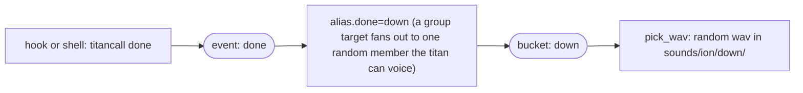

# titancall

> *Protocol 3: Protect the Pilot.* A notification router that speaks Titanfall 2 Titan voice lines.

One CLI every project and hook pipes into. Each project registers as a specific Titan; firing an
event plays a fitting voice line from that Titan, on a selectable macOS output device.

```
titancall done &      # this project's Titan: "Enemy Titan down."
titancall error &     # "Critical damage sustained."
titancall start &     # "Pilot mode online."
```

## Install

```sh
./install.sh                  # symlinks bin/titancall -> ~/.local/bin, seeds config
./install-hooks.sh            # wires the Claude Code hooks into ~/.claude/settings.json (idempotent)
brew install switchaudio-osx  # only needed to route to a non-default output device
```

`install-hooks.sh` merges into existing hooks — it never clobbers what's already there, and re-running
is a safe no-op. Pass a path to target a different settings file: `./install-hooks.sh ./.claude/settings.json`.
Mute without touching hooks: `titancall off` (re-enable with `titancall on`).

Because installing is purely **additive**, retargeting an event in the `EVENTS` map leaves the old hook
behind and both fire. `./install-hooks.sh --prune` removes any titancall hook the map no longer wants;
without the flag they're only reported. Anything not in the map counts as stale — so a hand-added
titancall hook gets pruned. Add it to `EVENTS` instead, and it survives.

**Shell completion** — `install.sh` also wires up tab-completion for bash & zsh (symlinks into a
writable completions dir, or prints the line to add — never edits your rc file). Completions are
*live*: `titan <TAB>` lists installed Titans, `output <TAB>` lists your audio devices, `<TAB>` /
`play <TAB>` lists events + buckets, `alias <event> <TAB>` lists buckets — all driven by a hidden
`titancall __complete` verb, so they stay in sync as titans/devices/aliases change. New shell to load.

Voice library lives outside the repo (it's ~400M of `.wav`) at
`~/.local/share/titancall/sounds/<titan>/<event>/`. Drop new lines there and run `titancall normalize`.

## Titans (13)

`bt · ion · jarvis · legion · monarch · northstar · portal · protoss · ronin · scorch · terran · tone · zerg`

`terran`, `protoss` and `zerg` aren't Titans — they're StarCraft voices, ripped from the two game discs
(Brood War + the original). `terran` is the full one (~258 lines: Marine, SCV, Firebat, Ghost, Advisor, plus
mission-chatter panic like "Uhh... how do you work this damn thing?"). `protoss` (~69) is Zealot/Templar/Advisor
speech. `zerg` is deliberately thin (~20): Zerg units are creature noise, so only the Advisor and Cerebrate
speech got named; the growls are unsorted and degrade through the bucket fallbacks. Sorted by keyword rules and
hand-corrected, so expect the odd mis-race or mis-bucket — move them in `titancall ui`.
Provenance and how to rebuild: `data/terran-source.tsv` (Brood War disc), `data/starcraft-source.tsv` (original
disc), `scripts/mpq_extract.py`.

## Events

Hooks speak dev-words; config aliases map them to Titan voice-line **buckets**:

| event (alias) | bucket | sounds like |
|---------------|--------|-------------|
| `done`    | down   | "Enemy Titan down" |
| `success` | core   | "Laser core ready" |
| `error`   | damage | "Critical damage sustained" |
| `fatal`   | eject  | "Eject, eject!" |
| `warn`    | warn   | "Warning" |
| `start`   | enter  | "Pilot mode online" |
| `notify`  | follow | "Following your lead, Pilot" |
| `working` | attack | "Engaging Titan" |
| `idle`    | guard  | "Guard mode activated" |
| `subagent` | mount | "Friendly pilot on board" (a subagent mounts up) |
| `subagent-done` | dismount | "Friendly pilot has left your Titan" |

Raw buckets are also playable directly:
`down core damage eject warn enter follow attack guard exit mount dismount misc`.

### Degradation — a thin voice never goes silent

Only two voices have friendly-boarding lines, so `mount` would be silence for the other eight. Instead
each bucket carries a **fallback chain** of nearest-meaning buckets (`BUCKET_FALLBACK` in `bin/titancall`):
`mount → enter → follow`, `dismount → exit → guard → follow`, `eject → damage → warn`, and so on. First
bucket in the chain that actually holds wavs wins; then `misc`; then any clip the voice has at all. The
**result** is what gets logged, so `titancall log` shows the bucket that really played, not the one asked
for. A Titan with six clips still speaks on every event — just with a wrong-but-plausible line.

### Groups — one event, several buckets

A **group** is a named set of buckets. Point an event at a group and each fire draws from any member,
so a frequent event stops sounding like a broken record:

```sh
titancall group set combat attack,down,warn   # or space-separated
titancall alias working combat                # TaskCreated now pulls from all three
titancall group list                          # combat  attack,down,warn
titancall group rm combat
```

Members are narrowed per-voice at play time: a Titan with no `warn/` folder simply never draws `warn`
from the group instead of falling back to `misc`.

**Confirmation chirps** — some commands play an immediate sound (bypassing cooldown, respecting mute):
`titan here <name>` / `titan <name>` greet you in that voice; `output <device>` chirps **on the new device**
so you confirm routing; `volume <n>` plays at the new level; `on` proves sound is back.

## How routing works

One fire, three decisions: which titan speaks, which bucket the event lands in, which wav gets
picked. Callers speak dev-words, sound folders speak titan-words, and `alias.*` (optionally
through a `group.*`) bridges the two:



An event with no alias falls through as a bucket name, so `titancall attack` plays raw buckets
directly. A project's `.titan` file can also carry `key=value` overrides that beat the global
config (`titancall project`). The full model — titan identity precedence, the mute/cooldown
gates in `cmd_play`, bucketing authority, and the `.titan` overlay — is diagrammed with worked
traces in **[docs/routing.md](docs/routing.md)**.

## Per-project identity

Active Titan is resolved by precedence:

```
$TITANCALL_TITAN  >  nearest ./.titan (walks up)  >  registry (by project path)  >  claim next free Titan
```

- **Claim**: first time an unregistered project fires, it grabs the next unused Titan, writes `./.titan`,
  and records it in `~/.config/titancall/registry`. Unique until you exceed 10 projects (then load-balances).
- `titancall whoami` — show this project's Titan and *why*.
- `titancall titan here <name>` — pin a project deliberately.
- `titancall roster` — table of every project → Titan → last fired.
- `titancall roster prune [-n]` — forget projects whose directory is gone (`-n` previews). Freed Titans
  become claimable again.
- `titancall roster forget [--purge] [<path>|<titan>]` — forget one row; bare = the current project. A
  Titan name that holds several projects is refused (it lists them) — name the path instead. By default
  the project's `.titan` is left alone, so a still-existing project re-registers on its next fire;
  `--purge` drops the identity too (keeping any per-project overlay lines).

Because Claude Code runs hooks in the project's directory, a **single** global hook gives every agent its
own voice automatically — no per-project hook config.

## Claude Code wiring

Run `./install-hooks.sh` to wire these into `~/.claude/settings.json` (idempotent, preserves existing hooks):

| Claude Code hook | titancall event | sounds like |
|------------------|-----------------|-------------|
| SessionStart       | start   | "Pilot mode online" |
| Stop               | follow  | "Solid copy" (per-turn ack, back to you) |
| Notification       | notify  | "Following your lead, Pilot" |
| PreToolUse (matcher `Task`) | subagent | "Friendly pilot on board" (a subagent launches) |
| SubagentStop       | subagent-done | "Friendly pilot has left your Titan" |
| PostToolUseFailure | error   | "Critical damage sustained" |
| PermissionRequest  | warn    | "Warning" |
| TaskCreated        | working | "Engaging Titan" (work begins) |
| TaskCompleted      | guard   | "Guard mode activated" (holding results until you return) |
| Elicitation        | notify  | "Following your lead, Pilot" (MCP asks for input) |
| PostCompact        | start   | "Pilot mode online" (back online after compaction) |
| SessionEnd         | exit    | "Disengage" |
| WorktreeCreate     | mount   | "Friendly pilot on board" (work moves into an isolated worktree) |
| WorktreeRemove     | dismount | "Friendly pilot has left your Titan" |

Bare `PreToolUse`/`PostToolUse` are excluded — they fire on every tool call. The one exception is
`PreToolUse` narrowed to the `Task` matcher, which fires only when a subagent launches: the sole signal
with no dedicated hook of its own, and the sole matcher-scoped entry in the map. Keep it that way.

Deliberately **not** mapped, though the hooks exist: `InstructionsLoaded` (fires on every CLAUDE.md /
rule load), `ElicitationResult` (`Elicitation` already announced the ask; the result is your own
keypress), `ConfigChange` (settings edits are usually yours — including this wiring).

Edit the `EVENTS` map in `install-hooks.sh` to add/trim, then re-run it (`--prune` to drop what you
retargeted away from). Too chatty? `titancall off`.

**Cooldown** — a burst of the same event (e.g. `SubagentStop` firing once per subagent in a workflow)
would stampede the same voice. `titancall` enforces a per-voice minimum gap (default 4s): within the
window, extra fires return silently. Distinct titans can still overlap. Tune with `titancall cooldown <secs>`
(0 = off). State lives in `~/.local/share/titancall/state/<titan>.last`.

A **per-event** override beats the global gap — `cooldown.<event>`, and likewise `volume.<event>` for
loudness. The shipped config leans on this to keep the chatty hooks in the background without muting
the rare ones:

```sh
titancall config set cooldown.follow 45   # per-turn ack: at most one every 45s (shipped default)
titancall config set volume.error 1.0     # ...but never miss a failure
titancall config unset cooldown.follow    # back to the global gap
```

**Anti-repeat** — uniform random repeats itself audibly: a 3-wav bucket plays the same line twice in a
row one turn in three, and a 1-wav bucket is a metronome. Each voice remembers its last `recent` picks
(default 5, `titancall config set recent 0` to disable) and draws from what's left. The window is capped
at *bucket size − 1*, so it never shrinks a thin bucket to zero candidates — a repeat happens only when
the bucket genuinely holds one file.

## The console — `titancall ui`

A curses cockpit for the whole chain: **wav → bucket → group → event → hook**. It is the only part
that needs `python3`; playing sounds stays pure bash, so a box without python still gets notifications.

```
 titancall console  1 browse  2 events  3 groups  4 hooks       ion (via dotfile) | vol 0.7 | live
-------------------------------------------------------------------------------------------------
TITAN         BUCKET          WAV  [ion/attack]
bt         32 * all      36     engaging titan
ion        36 attack      5   * splinter rifle on target
jarvis     61 core        2     targeting
legion     52 damage     13     weapons energized
monarch    36 down        3
attack <- events: working
 tab pane  enter/p play  space mark  m move  x clear  / filter  r reload  1-4 screens  q quit
```

| screen | does |
|--------|------|
| **1 browse** | three panes (titan / bucket / wav). `enter` or `p` auditions a clip, `space` marks, `m` moves marked wavs to another bucket, `/` filters by transcript, `* all` lists every wav of a Titan at once |
| **2 events** | the alias layer: `enter` retargets an event at any bucket **or group**, `n` adds one, `d` removes, `p` fires it through the CLI. The `WAVS` column is how many clips this project's Titan can actually draw — `0` means that event is effectively silent for this voice |
| **3 groups** | `n` creates a group, `enter` toggles member buckets, `d` deletes, `p` previews. `USED BY` shows which events depend on it |
| **4 hooks** | read-only chain `Claude hook → event → target → wavs`, plus whether each hook is really wired in `~/.claude/settings.json`. `enter` retargets the *event* — hook wiring itself stays with `./install-hooks.sh` |

`q` quits; `esc` only backs out of an overlay or filter. Auditioning a clip plays even when muted
(you asked for it explicitly) — the header still shows `MUTED`.

**Moves are reviewable.** Reassigning a wav appends a row to the git-tracked `data/overrides.tsv`
and re-runs `build_manifest.py --apply`, which physically moves the file and regenerates
`data/buckets.tsv`. Nothing is hidden in a database: `git diff data/` shows exactly what you re-bucketed.

## Bulk re-sorting — `titancall review`

For sorting a lot of lines at once (a Titan with 27 clips dumped in `misc`), the console is the slow
way. Dump the whole library to a spreadsheet instead:

```sh
titancall review          # -> data/review.csv, one row per wav, plus a gap report
# edit the new_bucket column in Numbers/Excel/vim; leave rows you don't care about alone
titancall review apply    # folds edits into overrides.tsv, moves the wavs, regenerates the CSV
```

```csv
titan,transcript,bucket,new_bucket,file
jarvis,friendly pilot on board,misc,enter,friendly-pilot-on-board.wav
jarvis,friendly pilot has left your titan,misc,exit,friendly-pilot-has-left-your-titan.wav
jarvis,titan burn card enabled,misc,misc,titan-burn-card-enabled.wav
```

`apply` validates every row first — an unknown bucket or a filename that no longer exists aborts the
whole import with line numbers and changes nothing. Same authority as the console: it writes
`data/overrides.tsv`, which is merged *over* the curated `OVERRIDES` dict in `build_manifest.py`.

The gap report tells you what re-sorting **can't** fix — buckets where a voice simply has no clip:

```
gaps — buckets with no clips for that voice (these degrade down BUCKET_FALLBACK):
  jarvis     down guard follow exit
  portal     eject core guard attack
  northstar  down
```

Nothing in `misc` becomes a "guard mode" line if Jarvis never says one. A gap isn't silence — the
fallback chain covers it with the nearest plausible bucket — but nearest-plausible is still not the
line you wanted, and a voice missing the whole chain lands in `misc`, where Jarvis firing `done` may
announce *"your thriple threat wil now fire magnetic gernades."* Two ways to close a gap for real:
sort clips into the bucket (`titancall review`), or point the event at a **group** (`titancall group
set takedown down,attack,warn` + `titancall alias done takedown`) — group members are narrowed
per-voice, so a Titan lacking one member just draws from the others.

## Playback log

Every played line is appended to `~/.local/share/titancall/log` (tab-separated:
timestamp, event, titan, bucket, wav, project path) — so you can see which soundbyte
just fired from which project.

```
titancall log            # last 20 plays, table view
titancall log 50         # last 50
titancall log off        # disable logging (config key 'log'), if it ever causes lag
titancall log on         # re-enable
titancall log clear      # wipe the file
```

Logging is a single `printf >>` per play — effectively free — but `log off` (or
`titancall config set log 0`) turns it off entirely.

## Shell wiring

```sh
alias dn='titancall done'
long-build-command; titancall done   # speak when a long command finishes
```

## Commands

```
titancall <event>            play event for this project's Titan
titancall play <event>       same, spelled out
titancall random <event>     play from a random Titan
titancall on | off | toggle  global mute switch (hooks stay quiet when off)
titancall status             enabled/muted + titan + output
titancall ui                 curses console: wavs -> buckets -> groups -> events (needs python3)
titancall whoami | roster
titancall roster prune [-n] | forget [--purge] [<path>|<titan>]
titancall titan list | here <name> | <name>
titancall output list | <device> | default
titancall volume [0..1]
titancall cooldown [secs]    per-voice minimum gap; 0 = off
titancall lines [event]
titancall alias [<event> <bucket|group>]
titancall group list | show <n> | set <n> <b1,b2,...> | rm <n>
titancall project show | alias <e> <t> | group <n> <b,..> | set <k> <v> | unset <k>
titancall buckets            bucket names, one per line
titancall review [apply]     whole library -> data/review.csv for hand-sorting; apply folds it back
titancall normalize          re-bucket + rename installed wavs
titancall level              loudness-normalize the library to config 'loudness' LUFS (needs ffmpeg)
titancall config | test [event]
titancall config unset <alias.x|group.x|volume.x|cooldown.x>
titancall log [n] | on | off | clear

```
