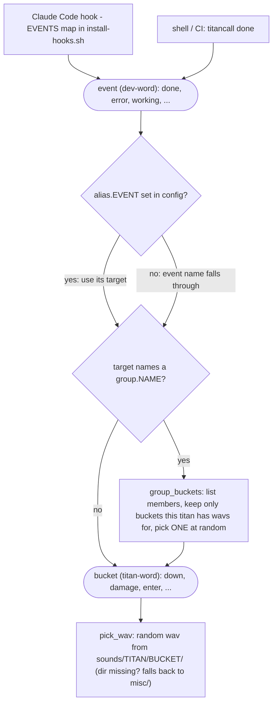
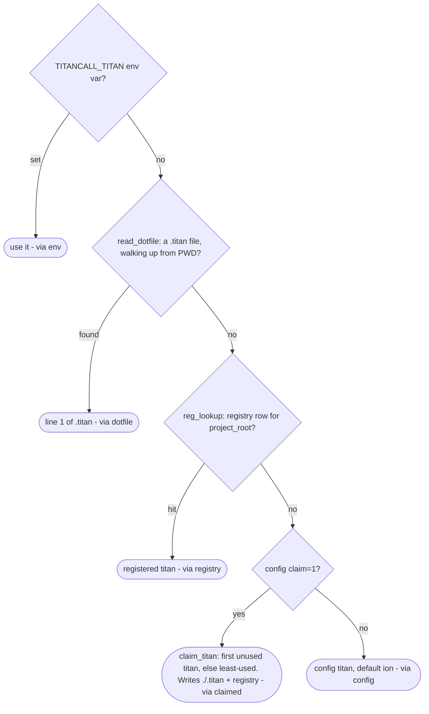
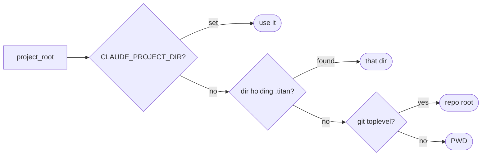
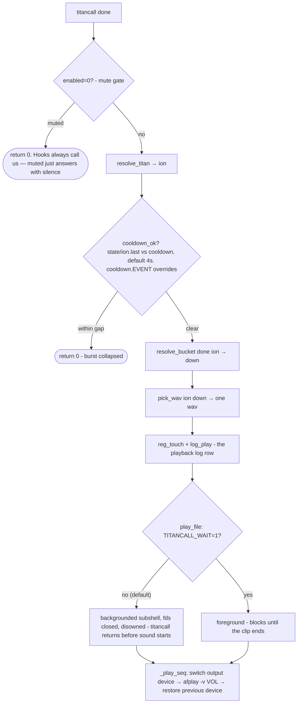
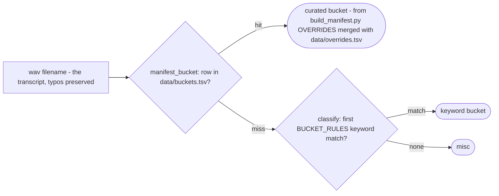
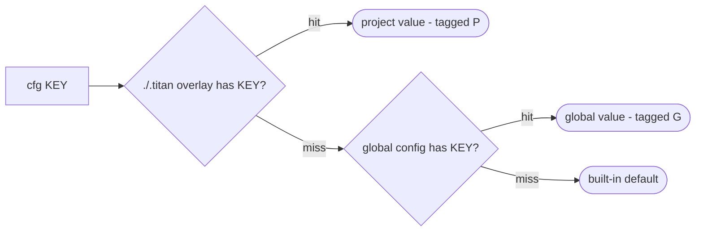

# Routing — how one `titancall done` becomes a voice line

Every fire makes exactly three decisions: **who speaks** (titan identity), **what they say**
(event → bucket → wav), and **whether now is the time** (mute gate, cooldown). This file maps
all three, plus the two supporting acts: where a wav's bucket assignment comes from, and how a
project overrides the global config. Every name in the diagrams is a real function or config key
in `bin/titancall` — grep them.

## 1. The chain: hook → event → bucket → wav

Callers speak *dev-words* (`done success error fatal warn start notify working idle`). The sound
folders speak *titan-words* (`down core damage eject warn enter follow attack guard exit misc`).
`alias.<event>` lines in the config bridge the two, and a `group.<name>` can stand in between as
a bucket multiplexer. That indirection is the whole trick: hooks never learn Titanfall
vocabulary, and you retune what "done" sounds like without touching a single hook.



*`resolve_bucket` is the middle of this diagram — alias lookup, fall-through, group expansion.
The fall-through arm is why raw bucket names play directly: `titancall attack` needs no alias,
and the stock `Stop` hook fires `follow` exactly this way (no `alias.follow` exists; the word
already is a bucket).*

**Worked trace #1 — the classic:**

```
$ cd ~/lab/spindle && titancall done        # or any hook wired at `done`
```

1. `resolve_titan` — no `$TITANCALL_TITAN`, no `.titan` file, but the registry has a row for
   `~/lab/spindle` → titan **ion** (via registry).
2. `resolve_bucket done ion` — config says `alias.done=down`; `down` names no group → bucket **down**.
3. `pick_wav ion down` — random draw from `sounds/ion/down/` → `enemy-titan-destroyed.wav`.
4. `play_file` detaches and returns; a beat later: *"Enemy Titan destroyed."*

**Worked trace #2 — an event pointed at a group:**

```sh
titancall group set combat attack,down,warn
titancall alias working combat
```

The `TaskCreated` hook fires `titancall working &` → `alias.working=combat` → `group_buckets
combat` = `attack down warn` → say scorch has no `warn/` folder, so members narrow to
`attack down` → `RANDOM` lands on `attack` → `pick_wav scorch attack` → *"Engaging enemy
Titan."* The next fire may draw `down` instead. That per-voice narrowing matters: a titan
missing one member bucket simply never draws it, instead of face-planting into `misc`.

## 2. Who speaks: titan identity (`resolve_titan`)

First hit wins. The winning source is exactly what `titancall whoami` reports.



And `project_root` — the registry key — has its own precedence:



*This pair is why ONE global hook gives every project its own voice: Claude Code runs hooks with
`CLAUDE_PROJECT_DIR` set, each project resolves to a different root, and the first fire from an
unregistered root claims the next free titan on the spot — writing `./.titan` and a registry row
so the voice sticks.*

**Example:**

```
$ titancall whoami
titan:   ion  (via registry)
project: /Users/you/lab/spindle
```

## 3. The gauntlet: `cmd_play`

A fire has to survive two gates before anything resolves, and playback itself is built to never
make a hook wait.



*The cooldown stamp is per-titan (`state/<titan>.last`), so `SubagentStop` firing nine times in
a workflow costs one line, not nine — while two different titans can still talk over each other.
Both playback paths run `_play_seq` (device switch → `afplay` → restore); `TITANCALL_WAIT=1`
just runs it in the foreground instead of a disowned subshell. Volume honors a per-event
`volume.<event>` override, then the global `volume`.*

**Example** — the only honest way to test audio, since default playback returns before sound:

```sh
TITANCALL_WAIT=1 titancall test done
```

## 4. Bucketing authority: which folder a wav lives in

`titancall normalize` decides a wav's bucket manifest-first, keywords second:



*`data/buckets.tsv` is the single authority; the console (`titancall ui`) and `titancall review
apply` both feed it through `data/overrides.tsv` + `build_manifest.py --apply`. The keyword
fallback only catches brand-new lines that no one has curated yet. Don't hand-edit `data/*.tsv`.*

## 5. Per-project overrides: the `.titan` overlay

`./.titan` is two things in one file: **line 1 is identity** (the titan name), and any
`key=value` lines below it are a **config overlay** that beats the global config for this
project only. `cfg()` reads the overlay first, so aliases, groups, volume, and cooldown all get
per-project behavior with zero special-casing in the routing code:



Write it through the CLI, never by hand — `cmd_project` preserves the titan line and validates
targets the same as the global commands:

```sh
titancall project show                  # titan + current overrides
titancall project alias done core       # this project's `done` → core/
titancall project set volume 0.4        # quieter voice here only
titancall project unset alias.done      # back to the global mapping
```

(The `titan` key is identity, not overlay — `titancall project set titan x` refuses; use
`titancall titan here <name>`.) `titancall config` prints the merged view tagged `[P]`/`[G]`
when an overlay is active, so you always know which layer won.

**Worked trace #3 — overlay beats global:**

```
$ cd ~/lab/reactor && titancall project alias done core
project alias: done -> core  (/Users/you/lab/reactor/.titan)

$ cat .titan
northstar
alias.done=core

$ titancall done
```

`cfg alias.done` hits the overlay → **core** (the global `alias.done=down` never gets a vote) →
`pick_wav northstar core` → *"Flight core online."* Every other project still plays `down/`.
Commit the `.titan` and the whole team's reactor checkout sounds like this.
